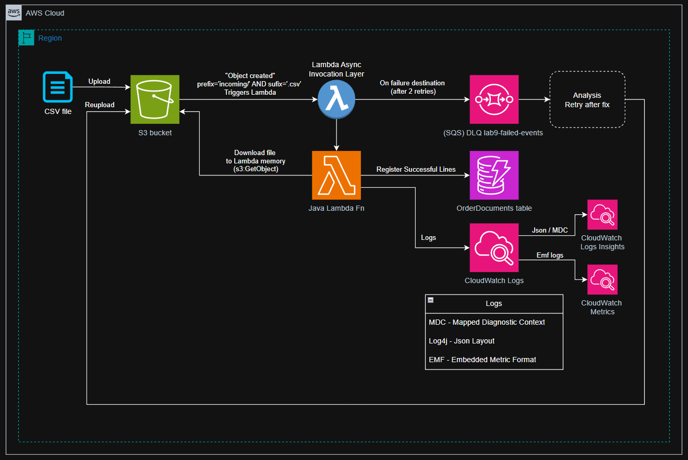

# Lab9 - S3 pipeline ingest CSV to DynamoDB

The goal for this lab was to process a batch of lines coming from a CSV to a DynamoDB database. The lines from CSV read with success are sent to DynamoDB; The lines with errors, skipped; The files not processed at all, sent to an SQS DLQ.

## Preamble

As you are going to see, the real goal for this lab was not exactly to create a CSV Lambda processor that helps to migrate CSV lines to an DynamoDB table. The real goal is to present/test different ways to observe the Function results through logs insights. Let's take a look on the details.

### Architecture of the Lab

Below you find the diagram of this laboratory. Next, the steps of execution.



1. To start the execution of the system, we upload a csv file from our account. In this lab, we simply upload the file using the aws cli.
2. The file reaches the S3 bucket, pre-configured to listen to new objects starting with `incoming/` and ending with `.csv`. That event will trigger our lambda function.
3. Inside the Lambda async invocation layer (represented by the lambda in the blue circle), it is set up a destination for files that attempted to be processed and failed, even after 2 retries. The entire file is considered a failure in that case, so we can start over from the very beginning, reuploading it to the bucket.
4. Looking to the happy path, the invocation layer manages to execute the function and start processing the file. In our case, it means that it downloads the file and, in memory, it parses it's content into lines.
5. Every line from the CSV (except the headers) will be processed and registered as on order to our OrderDocuments DynamoDB table.
6. While the processing happens, the function logs the results using three different techniques: 
   1. MDC (Mapped Diagnostic Context);
   2. Log4j (Json Layout logs);
   3. and EMF (Embedded Metric Format).

   All of them end up being a log inside CloudWatch Logs.
7. After that, CloudWatch manages to interpret the MDC to CloudWatch Logs Insights, and the EMF to CloudWatch Metrics.

### Structured Logging

As you noticed, the logging for this project was central for the observability lesson. We can collect data in several forms from the application logs.

The first and most common way to log what is happening in a Java app is using the Log4j2 library. It allows us to log using a JSON layout, what allows observability apps to query in the logging data.

The chosen layout is recognized pattern created by Elastic (Elasticsearch creators), used by its products in the ELK stack. The pattern is called ECSLayout and can be found in [Log4j2 setup file](src/main/resources/log4j2.xml). ECS stands for Elastic Common Schema (JSON schema).

With that configuration, AWS is able to interpret the logging information and separate the Level, the Timestamp and the message of the log line.

### MDC + Logging Insights

With the Log4j2 Layout set up, we can log the MDC (Mapped Diagnostic Context) for each Lambda Request/File. Lambda can process a list of events at once, so it can be called once to process several CSVs, in our case.

Knowing that, we define the context for the lambda request using both the Lambda Request Id and the Filename. With that combination, we know for sure that our lambda will generate a different but precise key for each processing of a file.

With MDC, the CloudWatch logs (using Log4j2) that the lambda generates will be used to identify the correct logs that matches with that specifically run.

So if you are debugging by querying the log lines with level "ERROR", for instance, the MDC will be there to make easy to get the filename that generated that error.

### EMF vs PutMetricData

Another technique for getting metrics from our business rules is to use EMF logs (Embedded metric format). The metrics from our csv processing lambda are preconfigured in [Emf.java](src/main/java/br/com/flaviohblima/Emf.java).

There we have our defined schema that represents the result of a processing. We have the Outcome (Success or Failure), the number of rows ingested or skipped, the duration of the run and the file name (ObjectKey). With that data, it is possible to use the CloudWatch Logs Insights to query the results of the runs.

The EMF logging is treat differently by AWS, it cannot be wrapped inside a Log4j2 json schema. It needs to be logged directly to System Out. By doing so, AWS collects it asynchronously and independently of our Lambda executions. It is important because of what is discussed next.

Two points are important to mention here:
1. If we want to collect metrics, we could use the PutMetricData that AWS offers to publish the metrics to CloudWatch. By using that resource, we would be binding some lambda run to the PutMetricData request. By making that synchronous, we could be delaying our results or, in a worse scenario, we could be binding to a request error. That's the reason because using EMF logging is better, it decouples the Lambda Execution from Metrics collection.
2. We also have to consider the dimensions of our metrics. Every dimension added creates a distinct metric we pay for. So, the lower the dimension cardinality, the cheaper. In our case, we used the 'Outcome' property for that, since it has two possible values: Success/Failure.

### Row-level vs File-level failure

Another aspect to discuss is the error threshold: when do we consider that there was a file-level failure and when there was a row-level failure.

Let's suppose one file was get from S3 and the lambda was able to identify it as an CSV file. The function starts to read each line, but every line has something wrong. Should we consider the entire file as a failure? Or should we register um failure per-row, since the file was read, despite the row-level errors?

Well, it clearly depends on how the team sees the errors. In this Lab, we have considered that if the Lambda was not triggered correctly, then the entire file failed; And if there was an attempt to read the file but all the rows had something wrong, then the file reading succeed, despite the row-level failures.

### Async invocation details

As you can see in the [architecture diagram](#architecture-of-the-lab), I've tried to differentiate the Lambda async invocation layer from the Lambda function itself.

The "async invocation layer" has the retry and failure destination configs. In this lab, I've configured a max of two retry attempts, so the expected behavior in a failure scenario is this:
1. The lambda is called and fails before executed (first attempt, but not a retry)
2. After 1 min, the async layer retries the execution, but it fails again (first retry attempt)
3. After 2 min, the async layer retries one last time (second retry attempt). If it fails again, then it considers that event as failed and will not retry anymore.

We are talking about an "Async" layer. What happens behind the scenes is that AWS Lambda Service creates a queue of Trigger Events for each Lambda Function it needs to call, buffering their executions. So, if we have a queue without a destination for failures, after the max retries configures, or after a long time enqueued, the event will be dropped.

Therefore, if we do not want to lose any failed event to be able to analyze and retry, we need to configure a Failure destination for that invocation queue. Here, I've configured an SQS queue to gather the failed invocations for future retries.

### Idempotent reprocessing

Talking about retries, if we want to reprocess one file, we can simply execute one command for S3 to replace the file with itself. It triggers the same file to be processed by the lambda function.

Now, imagine some line from that file was already processed and end up been sent again to the lambda function. We could be duplicating that register in the DynamoDB.

To prevent that, I've used a unique Sort Key for each line, that combines the filename with the line orderid. This way, each line of each file will be registered as a single line, even if it is reprocessed for some reason.

### Lambda + S3 configs

Here I gather some of the aspects of the pair S3 and Lambda services working together:
- It is good to know that the Object Keys (or filenames) that the Lambda receives from S3 events are encoded. So, one of the first steps in the Lambda is to decode the filename to get it back to an easier way to read.
- Another aspect is that the Lambda invocation can be called with one or more S3 events. It means that Lambda can be called with an array of files to be processed at once.
- The S3 buckets need to have unique names across AWS accounts. It means that someone can try to attack your stack by recreating one old bucket of yours putting some malicious files there. In order to prevent that, the lambda permission to be called includes both the Bucket name and the AccountId, resolving that danger.
- And last, but not least, instead of storing the csv data to the DynamoDB, the Lambda function could generate another file in the bucket. But, to reduce the probability of creating a recursion of read/write files from S3, it is recommended to define a `prefix` and a `suffix` for the files that can notify and trigger the Lambda Function.

## Setup

### Crete the bucket for the CSV file

```shell
ACCOUNT_ID=$(aws sts get-caller-identity --query 'Account' --output text)
BUCKET=lab9-ingest-$RANDOM
aws s3 mb s3://$BUCKET
```

### Create dynamo table

```shell
aws dynamodb create-table \
  --table-name OrderDocuments \
  --attribute-definitions \
    AttributeName=customerId,AttributeType=S \
    AttributeName=sk,AttributeType=S \
  --key-schema \
    AttributeName=customerId,KeyType=HASH \
    AttributeName=sk,KeyType=RANGE \
  --billing-mode PAY_PER_REQUEST
```

### Create a Failure Queue

```shell
FAIL_Q_URL=$(aws sqs create-queue --queue-name lab9-failed-events \
  --query 'QueueUrl' --output text)
FAIL_Q_ARN=$(aws sqs get-queue-attributes --queue-url $FAIL_Q_URL \
  --attribute-names QueueArn --query 'Attributes.QueueArn' --output text)
```

### Create the Lambda function Role

```shell
aws iam create-role --role-name lab9-lambda-role \
  --assume-role-policy-document file://trust.json
  
aws iam attach-role-policy --role-name lab9-lambda-role \
  --policy-arn arn:aws:iam::aws:policy/service-role/AwsLambdaBasicExecutionRole

sed -i 's/<BUCKET>/'${BUCKET}'/g' policy.json
sed -i 's/<FAIL_Q_ARN>/'${FAIL_Q_ARN}'/g' policy.json

aws iam put-role-policy --role-name lab9-lambda-role \
  --policy-name lab9-access --policy-document file://policy.json

ROLE_ARN=$(aws iam get-role --role-name lab9-lambda-role \
  --query 'Role.Arn' --output text)
```

### Create the Java Lambda Function

First build the project to upload it:
```shell
mvn -q package
```

Then, use it as the Lambda Function:
```shell
aws lambda create-function \
  --function-name lab9-csv-ingest \
  --runtime java21 \
  --role $ROLE_ARN \
  --handler br.com.flaviohblima.CsvIngestHandler::handleRequest \
  --zip-file fileb://target/lab9-s3-pipeline-1.0.jar \
  --memory-size 512 \
  --timeout 60
```

```shell
aws lambda wait function-active --function-name lab9-csv-ingest

aws lambda put-function-event-invoke-config \
  --function-name lab9-csv-ingest \
  --maximum-retry-attempts 2 \
  --destination-config "{\"OnFailure\":{\"Destination\":\"$FAIL_Q_ARN\"}}"
```

### Add the S3 Trigger to the Lambda Function

```shell
aws lambda add-permission \
  --function-name lab9-csv-ingest \
  --statement-id s3-invoke \
  --action lambda:InvokeFunction \
  --principal s3.amazonaws.com \
  --source-arn arn:aws:s3:::${BUCKET} \
  --source-account $ACCOUNT_ID
  
FN_ARN=$(aws lambda get-function --function-name lab9-csv-ingest \
  --query 'Configuration.FunctionArn' --output text)

sed -i 's/<FN_ARN>/'${FN_ARN}'/g' notification.json

aws s3api put-bucket-notification-configuration \
  --bucket $BUCKET --notification-configuration file://notification.json
```

## Testing

To test if the simple upload of a csv file to our bucket will trigger the lambda function, execute the command:
```shell
aws s3 cp orders.csv s3://$BUCKET/incoming/orders.csv
```

15 seconds should be enough to see the result at the dynamo table:
```shell
aws dynamodb scan --table-name OrderDocuments --select COUNT --query 'Count'
```

## Check the AWS Observability

Open the console and navigate to `CloudWatch -> Logs Insights`, and open the group `aws/lambda/lab9-csv-ingest`, there should be 2 rows malformed (intentionally).

For the metrics collected from logging, check the `CloudWatch -> Metrics` and see `Lab9/Ingestion` namespace.

## Retryability

To see the Failures queue, we can remove the DynamoDB statement from the role-policy and upload a copy from csv (you can name it `orders2.csv`).

Removing the policy:
```shell
sed -i 's/<BUCKET>/'${BUCKET}'/g' error-policy.json
sed -i 's/<FAIL_Q_ARN>/'${FAIL_Q_ARN}'/g' error-policy.json

aws iam put-role-policy --role-name lab9-lambda-role \
  --policy-name lab9-access --policy-document file://error-policy.json
```

Uploading the file with another name:
```shell
aws s3 cp orders.csv s3://$BUCKET/incoming/orders2.csv
```

Then watch the errors in the logs. 
You can force a retry replacing the file with itself inside the s3 bucket:
```shell
aws s3 cp s3://$BUCKET/incoming/orders2.csv s3://$BUCKET/incoming/orders2.csv \
  --metadata-directive REPLACE --metadata replayed=true
```

After two attempts, we can read the failed invocation event in the failure queue:
```shell
aws sqs receive-message --queue-url $FAIL_Q_URL --query 'Messages[0].Body'
```

To fix that sending, you can set up the correct policy, and then trigger the retry replacing the file one last time.

## Clean Up

```shell
aws s3 rm s3://$BUCKET --recursive
aws s3 rb s3://$BUCKET

aws lambda delete-function --function-name lab9-csv-ingest

aws dynamodb delete-table --table-name OrderDocuments

aws sqs delete-queue --queue-url $FAIL_Q_URL

aws iam delete-role-policy --role-name lab9-lambda-role --policy-name lab9-access
aws iam detach-role-policy --role-name lab9-lambda-role \
  --policy-arn arn:aws:iam::aws:policy/service-role/AWSLambdaBasicExecutionRole
aws iam delete-role --role-name lab9-lambda-role

aws logs delete-log-group --log-group-name /aws/lambda/lab9-csv-ingest
```